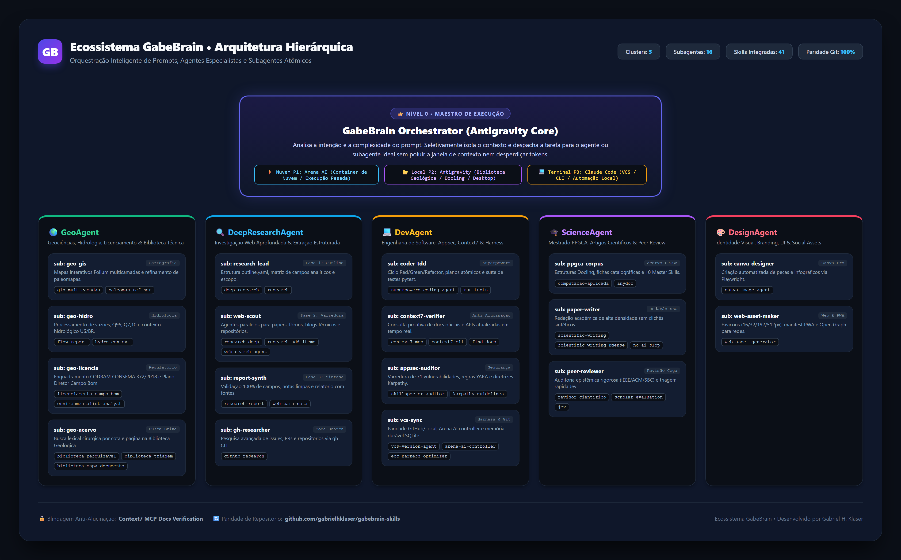

# GabeBrain Skills & Agents Hub 🧠⚡

Repositório central de **Master Skills**, agentes especializados e protocolos operacionais do ecossistema **GabeBrain** (@gabrielhklaser).

Serve de fonte da verdade para as skills, os agentes e as diretrizes que o **Claude Code** e o **Antigravity** usam. O roteamento de modelo e de skills acontece dentro de cada harness, por ganchos locais que consultam o Jev.

---

## 🧭 Roteamento nos harnesses (Jev)

A sessão principal roda no modelo mais leve e funciona como recepção. Antes de cada resposta, um gancho (`UserPromptSubmit` no Claude Code, `PreInvocation` no Antigravity) consulta o Jev e injeta o resultado no contexto. Os scripts ficam em `~/.claude/router/`.

- **Roteador de modelo** (`jev_router.py` no Claude Code; `jev_router_agy.py` no Antigravity): pergunta ao Jev o nível do pedido (simples, rotina ou difícil) e o risco de quebrar algo. O código escolhe o subagente e sobe um nível quando o risco ou a falta de confiança passam do limite.
  - Claude Code: `rapido` (Haiku), `padrao` (Sonnet) ou `profundo` (Opus). Trocar de modelo exige confirmação do Gabriel antes da delegação.
  - Antigravity: `gemini-3.8-flash` (simples), `claude-sonnet` (rotina), `gemini-4-argon` (difícil / rotina com subida) ou `claude-opus` (teto crítico), com os mesmos limiares (risco > 70% ou confiança < 0,5) e a mesma confirmação antes de trocar de modelo.
- **Roteador de skills** (`jev_skill_router.py` e `jev_skill_router_agy.py`): pergunta ao Jev qual skill da biblioteca serve, ou nenhuma. Se a chance passar de 50% e a confiança for 0,6 ou mais, o `SKILL.md` entra no contexto.
- A escolha manual do Gabriel (`/model`, seleção de modelo ou `[sem-roteador]` na mensagem) sempre prevalece.
- Os registros ficam em `decisoes.jsonl` e `skills_decisoes.jsonl`, no mesmo diretório.

---

## 📚 Catálogo das 28 Master Skills

As Master Skills residem no diretório [`master-skills/`](master-skills/) e formam a base teórica e normativa de raciocínio de todos os agentes:

| # | Master Skill | Descrição e Foco Técnico |
|:---:|:---|:---|
| **01** | [`Master_GIS_Geoprocessamento`](master-skills/Master_GIS_Geoprocessamento.md) | GeoPandas, Shapely, PyQGIS, Leaflet, Folium, SRS/EPSG, operações topológicas |
| **02** | [`Master_Hidrologia_e_Recursos_Hidricos`](master-skills/Master_Hidrologia_e_Recursos_Hidricos.md) | Telemetria ANA, curvas-chave, bacias hidrográficas, balanço hídrico superficial |
| **03** | [`Master_Auditoria_Documental_e_PDF`](master-skills/Master_Auditoria_Documental_e_PDF.md) | Extração de laudos, análise de conformidade ambiental, OCR, regex forense |
| **04** | [`Master_Seguranca_e_Auditoria_de_Codigo`](master-skills/Master_Seguranca_e_Auditoria_de_Codigo.md) | OWASP Top 10, sanitização de inputs, proteção de credenciais, AppSec |
| **05** | [`Master_Frontend_Design_e_UI_Engineering`](master-skills/Master_Frontend_Design_e_UI_Engineering.md) | Tailwind, React, Vue, CSS Tokens, Micro-interações, acessibilidade WCAG |
| **06** | [`Master_Orquestracao_e_Hive_Mind_Agentes`](master-skills/Master_Orquestracao_e_Hive_Mind_Agentes.md) | Protocolos multi-agente, consenso distribuído, hive mind, delegação |
| **07** | [`Master_Arena_AI_Agent_Controller`](master-skills/Master_Arena_AI_Agent_Controller.md) | *(legado)* Automação Playwright da Arena AI, GitHub branches arena/*, reconexão |
| **08** | [`Master_Spec_Driven_Development_e_Engenharia_Contexto`](master-skills/Master_Spec_Driven_Development_e_Engenharia_Contexto.md) | SDD, TDD, prompts baseados em especificações rígidas, contratos de API |
| **09** | [`Master_Transcricao_Ritmo_e_Notacao_Musical`](master-skills/Master_Transcricao_Ritmo_e_Notacao_Musical.md) | DSP de áudio, detecção de transientes, MusicXML, quantização rítmica |
| **10** | [`Master_Paleoclima_e_Geologia_Espacial`](master-skills/Master_Paleoclima_e_Geologia_Espacial.md) | Reconstruções paleogeográficas, interpolação climática, Deep Time |
| **11** | [`Master_Docling_Leitor_Documentos_GabeBrain`](master-skills/Master_Docling_Leitor_Documentos_GabeBrain.md) | IBM Docling, extração de tabelas complexas, equações LaTeX, chunking estruturado |
| **12** | [`Master_Biblioteca_Pesquisavel_e_Acervo_Tecnico`](master-skills/Master_Biblioteca_Pesquisavel_e_Acervo_Tecnico.md) | Busca léxica por página, citação formal estrita com cota e página |
| **13** | [`Master_Ontologias_e_Modelagem_Conhecimento`](master-skills/Master_Ontologias_e_Modelagem_Conhecimento.md) | Web Semântica, OWL, RDF, SPARQL, OntoUFO, modelagem conceitual |
| **14** | [`Master_IHC_e_Engenharia_Semiotica`](master-skills/Master_IHC_e_Engenharia_Semiotica.md) | Avaliação de comunicabilidade, Jakobson, design centrado no usuário |
| **15** | [`Master_Machine_Learning_e_Ciencia_de_Dados`](master-skills/Master_Machine_Learning_e_Ciencia_de_Dados.md) | Algoritmos espaciais, k-NN, DBSCAN, projeções LAMP/NCA, validação cruzada |
| **16** | [`Master_Engenharia_e_Arquitetura_Software`](master-skills/Master_Engenharia_e_Arquitetura_Software.md) | SWEBOK v4, Clean Architecture, SOLID, padrões de projeto, CI/CD |
| **17** | [`Master_Geoestatistica_e_Modelagem_Espacial`](master-skills/Master_Geoestatistica_e_Modelagem_Espacial.md) | Variografia, krigagem ordinária/indicadora, simulação estocástica SGS |
| **18** | [`Master_Geofisica_Computacional_e_Inversao`](master-skills/Master_Geofisica_Computacional_e_Inversao.md) | Campos potenciais (gravimetria/magnetometria), FFT, inversão geofísica |
| **19** | [`Master_Geotectonica_e_Cinematica_Placas`](master-skills/Master_Geotectonica_e_Cinematica_Placas.md) | Tectônica global, polos de Euler, abertura oceânica, ciclos de Wilson |
| **20** | [`Master_Geologia_Estrutural_e_Tensores`](master-skills/Master_Geologia_Estrutural_e_Tensores.md) | Elipsóide de deformação, tensores de tensão, critério Mohr-Coulomb |
| **21** | [`Master_Hidrogeologia_e_Modelagem_Fluxo`](master-skills/Master_Hidrogeologia_e_Modelagem_Fluxo.md) | Lei de Darcy, equação de Theis, ensaios de bombeamento, modelagem numérica |
| **22** | [`Master_Canva_Image_e_Design_Agent`](master-skills/Master_Canva_Image_e_Design_Agent.md) | Automação Canva Pro Playwright, design gráfico, manipulação de imagem Pillow |
| **23** | [`Master_Revisao_Cientifica_e_Escrita_Humanizada`](master-skills/Master_Revisao_Cientifica_e_Escrita_Humanizada.md) | Peer Review rigoroso (SBC/IEEE/ACM), Anti-AI Slop, conversão dissertação -> artigo |
| **24** | [`Master_SkillSpector_Seguranca_e_Auditoria_Skills`](master-skills/Master_SkillSpector_Seguranca_e_Auditoria_Skills.md) | NVIDIA SkillSpector: auditoria AppSec de skills de IA, 71 padrões, YARA, AST e Least Privilege |
| **25** | [`Master_ECC_Harness_e_Otimizacao_Agentes`](master-skills/Master_ECC_Harness_e_Otimizacao_Agentes.md) | Everything Claude Code: harness OS, economia de tokens, ciclo 6-fases, TDD e memória durável SQLite |
| **26** | [`Master_Superpowers_Engenharia_Codigo_e_Prompts`](master-skills/Master_Superpowers_Engenharia_Codigo_e_Prompts.md) | Superpowers: metodologia disciplinada de código a partir de prompts, brainstorming e planos atômicos |
| **27** | [`Master_LoopAgent_Governanca_e_QALoop`](master-skills/Master_LoopAgent_Governanca_e_QALoop.md) | Orquestrador geral: governança multi-agente, qa-loop limitado e pontuação objetiva com Jev |
| **28** | [`Master_QALoop_Governanca_e_Orquestracao`](master-skills/Master_QALoop_Governanca_e_Orquestracao.md) | Master do qa-loop: governança, hive mind e orquestração (qa-loop, jev) |

---

## 🛠️ Habilidades Executáveis (`skills/`)

Além das diretrizes teóricas, o repositório contém as implementações executáveis das ferramentas do agente:

1. **`arena-ai-controller`** *(legado, sem uso no fluxo)*: driver Playwright da Arena AI. A pasta foi mantida.
2. **`gis-multicamadas`**: Gerador e manipulador de mapas Leaflet/Folium em múltiplas camadas (geologia, poços, drenagem, vias) com medição métrica e alternância de basemaps.
3. **`vcs-version-agent`**: Agente de paridade bidirecional (GitHub <-> Local) e snapshots offline.
4. **`biblioteca-pesquisavel`**: Motor de indexação e busca léxica por página no acervo técnico.
5. **`biblioteca-triagem`**: Destilador de laudos, extração de confiança (A-E) e geração de fichas de síntese.
6. **`biblioteca-mapa-documento`**: Extrator de estrutura de documentos extensos (>50k tokens) e mergulho direcionado em capítulos técnicos.
7. **`computacao-aplicada`**: Módulo de acesso ao acervo do Mestrado PPGCA/Unisinos estruturado via Docling.
8. **`canva-image-agent`**: Automação do Canva Pro via Playwright e motor local de manipulação gráfica (redimensionamento Lanczos, corte, otimização).
9. **`revisor-cientifico-peer-review`**: Simulador de parecerista sênior (SBC/IEEE/ACM/Elsevier) com auditoria em 5 etapas e checklist canônico de manuscritos.
10. **`texto-natural-ptbr`**: Edição de texto em português brasileiro (parecer, ofício, e-mail, linguagem simples) para soar natural e fiel ao autor (forge-z, MIT). A antiga `escrita-tecnica-humanizada` foi aposentada em 2026-11-15 e absorvida pela `no-ai-slop`.
11. **`skillspector-auditor`**: Agente e scanner de segurança para skills de agentes de IA baseado no NVIDIA SkillSpector.
12. **`ecc-harness-optimizer`**: Sistema operacional de harness e otimizador de contexto/tokens de agentes (Everything Claude Code - ECC).
13. **`superpowers-coding-agent`**: Agente de desenvolvimento disciplinado de código a partir de prompts (obra/superpowers).
14. **`desktop-screenshot`**: Captura de telas de aplicações desktop e publicação em PRs do GitHub com URLs imutáveis e commits de snapshots (sem hosts de imagem terceiros).
15. **`sprout-cli`**: Interface CLI multi-agente para mensageria Nostr (canais/DMs), workflows, feed de eventos, proteções de branch e memória persistente chave-valor (`mem`).
16. **`github-research`**: Pesquisa especializada de histórico de issues, PRs mesclados e código via GitHub CLI (`gh`).
17. **`anydoc`**, **`no-ai-slop`**, **`scientific-writing`**, **`scientific-thinking-scholar-evaluation`**: conversão de documentos, filtro anti-slop e escrita/avaliação científica.
18. **`web-asset-generator`**: Geração profissional de web assets (favicons, ícones PWA Android/iOS, imagens Open Graph/Twitter Cards e metatags HTML) a partir de logos, textos ou emojis, com validação de dimensões e contraste WCAG.
19. **`deep-research`** (`research`, `research-add-items`, `research-add-fields`, `research-deep`, `research-report`): Pesquisa profunda em 3 fases inspirada no paper RhinoInsight (geração de outline, investigação paralela com validação estrita de esquema JSON e compilação de relatório Markdown com índice ancorado).
20. **`context7`** (`context7-cli`, `context7-mcp`, `find-docs`): Recuperação em tempo real de documentação oficial e exemplos de código verificados para qualquer biblioteca, framework ou SDK via CLI (`ctx7`) e MCP nativo (`resolve-library-id`, `query-docs`). Elimina alucinações de APIs obsoletas ou inexistentes.
21. **`ponytail`** (`ponytail`, `ponytail-review`, `ponytail-audit`, `ponytail-debt`, `ponytail-gain`, `ponytail-help`): Filosofia e ferramental de desenvolvedor sênior pragmático (DietrichGebert/ponytail). Aplica a escada YAGNI (recurso nativo/stdlib antes de dependências e código customizado), gerando código mínimo funcional sem abrir mão de validação, segurança e tratamento de erros. Inclui auditoria e revisão anti-overengineering.
22. **`ui-ux-pro-max`**: Inteligência avançada de design de interfaces UI/UX (nextlevelbuilder/ui-ux-pro-max-skill). Motor BM25 local para recomendação de 79 estilos de interface, 192 paletas de produtos, 74 combinações de tipografia, 119 diretrizes de usabilidade/acessibilidade WCAG e suporte a 22 stacks tecnológicas (React, Next.js, Tailwind, Vue, Svelte, Flutter, SwiftUI, etc.).
23. **`caveman`** (`caveman`, `caveman-commit`, `caveman-compress`): Modo de comunicação ultracompacta e economia extrema de tokens (JuliusBrussee/caveman). Elimina artigos, saudações, preâmbulos e narração supérflua de ferramentas, mantendo 100% do rigor técnico, comandos e blocos de código. Inclui gerador de Conventional Commits sem fluff e compressor de arquivos de memória.
24. **`watch`** (bradautomates/claude-video): Assiste a vídeos (yt-dlp + ffmpeg + legendas) para responder perguntas sobre o conteúdo. Por padrão só legendas, sem chave de API. Requer ffmpeg, ffprobe e yt-dlp.
25. **`impeccable`** (pbakaus/impeccable): Revisão e acabamento de interfaces (critique, audit, polish, harden…) com detecção de design genérico de IA. Complementa o `ui-ux-pro-max`. Importada sem hooks.
26. **`graphify`** (safishamsi/graphify): Grafo de conhecimento consultável de um projeto ou pasta (código via AST, documentos via extração semântica). Usada pelo subagente `project-reader`. Importada sem hooks.
27. **`obsidian-skills`** (kepano): `obsidian-markdown`, `obsidian-bases`, `json-canvas` e `obsidian-cli` para escrever e operar o vault no formato nativo do Obsidian.

### 🔁 Sincronização (este repo é a fonte da verdade)

```bash
python scripts/sync_gabebrain.py            # mostra o que mudaria
python scripts/sync_gabebrain.py --apply    # aplica
```

- `skills/` → `~/.gemini/config/skills` (todas) e `.claude/skills` / `.agents/skills` do vault (só as que já estão lá).
- `master-skills/` ← `📚 Biblioteca de Agentes/` do vault (lá é onde se edita).
- Regenera as notas `20-Skills/` do vault.
- Nunca copia `.env`/perfis de navegador para o vault; remove `.env` que encontrar lá.
- Se um destino foi editado **depois** do repo, reporta `CONFLITO` e não sobrescreve.

---

## 👑 Arquitetura Hierárquica Multi-Agentes (5 Clusters & 26 Subagentes)

O GabeBrain adota uma divisão em 5 clusters especializados com 26 subagentes atômicos para execução paralela, baixo consumo de tokens e contexto limpo:



### 🌍 1. GeoAgent (`agents/geo-agent.md`)
*Geociências, Hidrologia, Licenciamento & Acervo Técnico*
- `sub: geo-gis` (`agents/geo-gis.md`): Cartografia digital, mapas interativos Folium multicamadas e refinador de paleomapas.
- `sub: geo-hidro` (`agents/geo-hidro.md`): Análise de séries de vazões, Q95, Q7,10 e convenções hidrológicas ANA/USGS.
- `sub: geo-licencia` (`agents/geo-licencia.md`): Enquadramento ambiental municipal de Campo Bom/RS e CONSEMA 372/2018.
- `sub: geo-acervo` (`agents/geo-acervo.md`): Busca e leitura cirúrgica por cota/página na Biblioteca Geológica do Drive.

### 🔍 2. DeepResearchAgent (`agents/deep-research-agent.md`)
*Pesquisa Profunda na Internet & Extração Estruturada em 3 Fases*
- `sub: research-lead` (`agents/research-lead.md`): Fase 1 - Estruturação de `outline.yaml` e matriz de campos `fields.yaml`.
- `sub: web-scout` (`agents/web-scout.md`): Fase 2 - Varredura especializada com agentes paralelos e módulos temáticos.
- `sub: report-synth` (`agents/report-synth.md`): Fase 3 - Validação 100% de dados via JSON, notas limpas e relatório final.
- `sub: gh-researcher` (`agents/gh-researcher.md`): Mineração de código, repositórios, PRs e issues via gh CLI.

### 💻 3. DevAgent (`agents/dev-agent.md`)
*Engenharia de Software, AppSec, Context7 & Harness*
- `sub: coder-tdd` (`agents/coder-tdd.md`): Ciclo TDD Red/Green/Refactor, planos atômicos e suíte de testes pytest.
- `sub: context7-verifier` (`agents/context7-verifier.md`): Blindagem anti-alucinação com consulta proativa a documentação oficial.
- `sub: appsec-auditor` (`agents/appsec-auditor.md`): Auditoria de 71 vulnerabilidades, regras YARA e diretrizes Karpathy.
- `sub: vcs-sync` (`agents/vcs-sync.md`): Paridade Git GitHub/Local e harness optimizer.

### 🎓 4. ScienceAgent (`agents/science-agent.md`)
*Produção Científica, Mestrado PPGCA & Peer Review*
- `sub: ppgca-corpus` (`agents/ppgca-corpus.md`): Acervo estruturado Docling do mestrado e leitor documental universal.
- `sub: paper-writer` (`agents/paper-writer.md`): Redação científica de alta densidade sem clichês de IA (anti-AI slop) e k-dense.
- `sub: peer-reviewer` (`agents/peer-reviewer.md`): Simulação de parecerista sênior (IEEE/ACM/SBC) e triagem rápida Jev.

### 🎨 5. DesignAgent (`agents/design-agent.md`)
*Identidade Visual, Branding & Assets Digitais*
- `sub: canva-designer` (`agents/canva-designer.md`): Automação de designs com Canva Pro autenticado via Playwright.
- `sub: web-asset-maker` (`agents/web-asset-maker.md`): Geração completa de favicons, ícones PWA e imagens Open Graph.

---

## 👥 Personas Adicionais (`agents/meadow-core/`)

- **`@Skip`** (`agents/meadow-core/skip.persona.md`): Orquestrador central de equipe.
- **`@Bana`** (`agents/meadow-core/bana.persona.md`): Revisor arquitetural com foco no big picture.
- **`@Lev`** (`agents/meadow-core/lev.persona.md`): Especialista em segurança, auditoria de código e superfície de ataque.
- **`web-search-agent`** (`agents/web-search-agent.md`): Motor de busca profunda modular (`web-search-modules/`).

## 🗂️ Legado

Estes itens continuam no repositório, mas não fazem parte do fluxo atual: `skills/arena-ai-controller`, `master-skills/Master_Arena_AI_Agent_Controller.md`, `skills/prompt-router-coordinator`, `agents/prompt-router.md` e `protocols/arena_antigravity_bridge.md`.
